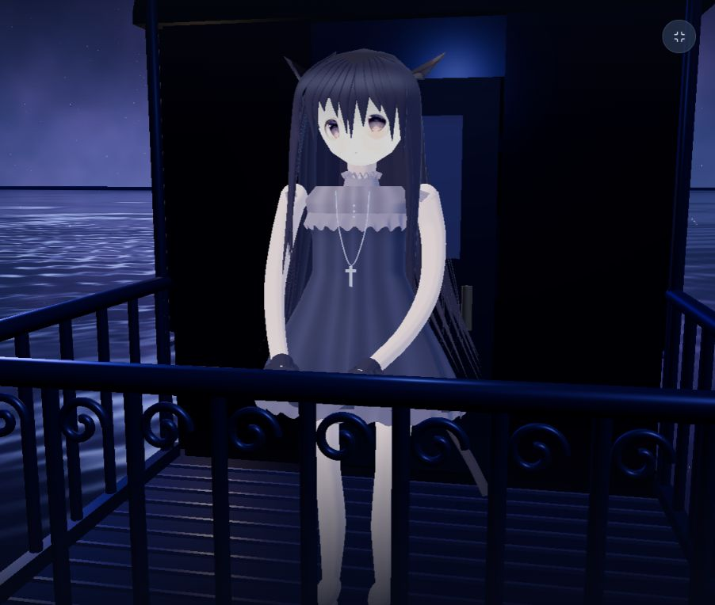

# NOIR · 星海列车

以工作区的 `11v3.mp4` 与 `night-cinema.mp4` 为视觉参考的实时 Three.js 场景。不是视频背景，也不是从视频自动恢复的原始模型。



## 从 GitHub 克隆运行

需要 Node.js 22.13.0 或更新版本。

```sh
git clone https://github.com/zhuge-Tom/noir-starline.git
cd noir-starline
npm ci
npm run build
npm start
```

打开 http://127.0.0.1:3000/ 。构建完成后，Windows 也可以双击仓库根目录的「启动星海列车.cmd」启动并打开页面。

源码、当前人物贴图及页面内参考视频已包含在仓库中；开发依赖、构建产物、本机日志与临时对照图不提交。原始工作区的完整视频与历史对照图不影响项目运行。

## 使用

- `npm install`，`npm run dev`，打开终端给出的地址。
- 电影视角缓慢环绕；自由环绕可拖动、缩放和平移。
- 进入场景后 WASD / 方向键移动，拖动画面转向，Q / E 降低或升高，Shift 加速。
- 触屏可拖动转向，并使用屏幕方向键移动。
- 车厢内部不可穿入；场景移动为悬浮观察模式，不是带重力的步行模拟。
- H 隐藏 / 显示界面，Esc 显示界面。静音参考视频只出现在对照弹窗内。

## 实现范围

三节列车、暖色窗灯、弧形车顶、车尾露台及卷纹栏杆、轮组与轨道；风格化猫耳人物的三维几何、眨眼、头部微动、逐发束形变、裙摆形变；程序化星空、星云、漂浮光粒与动态水面。水面使用独立镜面相机反射场景，并以法线波纹扭曲倒影。设置可调风力、水纹、星光、反射和画质。

角色外形及列车不可见部分为近似重建，非精确复刻、非自动骨骼动作捕捉。没有添加声音。原始 `11v3.mp4` 检测到音频轨，但未使用或提取。

## 验证

`node node_modules/typescript/bin/tsc --noEmit`
`node scripts/verify.mjs`
`npm run build`

第三版已获用户授权并执行浏览器交互与截图对照：正面、侧面、原画/视频弹窗。WebMCP 为可选渐进增强，当前环境未验证其宿主接口。

参考实现文档：[Three.js OrbitControls](https://threejs.org/docs/pages/OrbitControls.html) / 本地依赖中的 Water.js。

## 第二版人物改进（历史，已由第三版替换）

重新建模的收窄下颌、平滑四肢与手指、褶皱裙面和波浪衬裙、重叠刘海、密集长发和飞散细发。面部采用独立生成的动漫漫反射贴图，仍贴在三维曲面上，不是整个人物广告牌；可从侧面和背面观察。角色使用亮度受限的自定义卡通材质，防止被列车灯光冲白；降低全局曝光、人物补光与 Bloom。默认进入角色近景。

脸部贴图由内置 image_gen 根据原片人物参考生成，文件 `public/face-albedo-v2.png`。提示词要点：正交动漫脸部 albedo、灰紫肤色填满方图、原片风格淡紫灰眼睛与细密睫毛、无头发无轮廓无耳颈、无强高光和过曝；眼中心30%/70%宽与46%高，鼻50%/61%，嘴50%/73%。这是参照重绘，不是从原片提取的原始纹理。

发布使用静态导出，不包含可接收请求的 React Server Functions 或开发服务器。脚手架依赖审计仍有告警，开发服务器仅绑定本机，不向网络开放。

## 本机稳定入口（线上被拦截时）

工作区根目录双击「启动星海列车.cmd」，或在项目内执行 `node scripts/launch-local.mjs`。
地址为 http://127.0.0.1:3000/ ，只在本机监听。后台服务不依赖当前对话保持运行；电脑重启后需要再次启动。
服务器只提供 dist/client 中的构建文件，不暴露源代码。支持视频 Range 请求。`npm start` 可在前台运行，`npm run test:local` 验证入口、页面资源、视频范围和源文件隔离。

2026-09-06 线上访问排查：正常访问线上地址返回 Cloudflare 403 / “Sorry, you have been blocked”，CF-Ray a36eaa220c7c72ce-HKG。Sites 元数据为 active、disabled_by=null、owner-only。属于托管边缘层访问拦截，具体触发规则不可见；未更改私有权限、未绕过平台访问控制、未宣称线上修复。本机入口为独立的可用替代方式。原线上故障需由托管平台排查。

## 第三版：原始立绘校准（2026-09-07）

使用用户提供的 neutral_gentle.png、calm_closed.png 和局部 Live2D 图集，复制到 public/character；未修改 G 盘原始资产。原图文件校验一致。停用第二版生成脸和自定义眼部着色器，用原始睁眼/闭眼贴图保持五官身份。重新校准全身比例、长腿、灰色高领、十字项链、手套和赤足，删除错误蝴蝶结；长发改为贴图曲面发束及低幅摆动，弱化皮肤亮度，修复图集透明区域造成的碎线。

重要限制：这是三维体块结合曲面原画投影的混合重建，不是原角色完整精细建模。正面贴图最接近原画；严格侧面、背面和关节仍有简化与接缝。局部 Live2D 不作为完整模型运行，不能保证全角度一致。保留场景移动、列车、星空及实时水面倒影。

增加原画/视频对照入口及纹理加载错误提示。已通过 TypeScript、几何动画检查、静态构建和本地 HTTP 资源/视频 Range 测试；浏览器实测高清约 58–59 FPS（当前机器、1280×720 视口，不代表所有设备）。线上 403 未修复，本轮更新仅在本机入口交付。

### 侧面缝隙修复

将独立脸片/头球/不匹配的耳背替换为按原立绘透明轮廓构造的封闭背衬（head-shell.ts + head-shell-data.json）。前后表面共用边界连接，耳部厚度收薄，连接面使用不透明材质，避免原贴图 alpha 裂缝透出背景。长发添加连续内衬，发根按同一头部旋转变换加权跟随。保留原画面部贴图，不改变角色身份。

新增 scripts/verify-seams.mjs：旧版本缺少封闭头壳时失败，修复后检查每条几何边恰好连接两面、内衬存在、材质不透明及动画坐标有限。已复测浏览器侧面和背侧近景。模型仍为混合重建，侧面造型简化不等于所有细节已精确还原。


## 第四版：头颈结构重建（替代第三版轮廓挤出）

停用 head-shell.ts / head-shell-data.json 的轮廓挤出方案及整块脸部曲面。anatomical-head.ts 用闭合椭圆截面构造头颅、脸颊、逐渐收窄的下颌与圆润颏部，并添加独立的锥形颈部与贴合颈围的实体布领。原立绘只提供正面五官/头发表面颜色；UV 不再取用立绘的颈部区域。下颌和后脑都有实际体积，颈部坐落于下颌后方并与身体重叠连接，而非用横板封口。

保留柔白四肢，给下颌单独匹配脸部颜色。修复混合材质缺少顶点色时下颌发黑的问题。新增“场景设置 → 低角度检查头颈”，并允许环绕到仰视角度；不会通过限制视角掩盖问题。已在浏览器检查仰视、正面、侧前方和背侧，几何闭合/下颌深度/材质色属性/本地 HTTP 测试通过。头发、耳朵及侧背部细节仍是简化造型，并非原始完整角色模型。

## 第五版：独立刘海与分层动态头发

新增 layered-hair.ts，将刘海、侧发、后发、细发与内层体积分成 105 个独立封闭发束（包含 12 束主刘海）。使用原 Live2D 发色图集给真实三维发束上色，不再使用大面积长发平片。根部固定，形变权重向发梢增加；长发采用更大的摆幅和沿长度延迟，刘海幅度较小。当前为程序化风动，并非带碰撞的物理毛发解算。

face-albedo.ts 在材质采样阶段保留原眼睛和嘴部，排除原立绘烘焙刘海，补为皮肤色。未改写用户原始图片。设置中可“隐藏独立头发 · 检查脸部”，已实际浏览器显隐对照，确认没有整片刘海残留。眼眉附近仍受原始立绘遮挡信息限制，并不是原始裸脸贴图。

测试：verify-hair.mjs 检查所有发束形变、固定发根、风力归零恢复、显隐与脸部独立材质；TypeScript、几何测试及本地资源测试通过。浏览器检查了近景、无发束脸部、高风力画面。仍是风格化重建，不宣称达到精细原始模型品质。

### 视频近景校准：刘海长度与安静眼神

对照 reference-frames/detail.png 的视频近景，延长中部刘海到眉眼之间、延长两侧贴颊发束，增加发束末段覆盖宽度，减小刘海风动幅度，避免露额过多。微调下巴与下颊宽度，并将原眼部像素垂直开合收窄约 11%，靠近原片较安静的神态；没有重新把刘海绘入脸部。浏览器已检查近景覆盖和双眼可见情况。该调整仍是参照重建，不是原视频角色的精确模型或逐帧表情捕捉。

### 五官与衣服/手臂分离校正
- 上移原画眼部采样位置，嘴部轻微上移；对应眼睛的刘海尖端留出空间，保留较长中心与侧发。
- 衣服不再直接使用含有手臂、头发和项链的完整立绘投影，改为独立布料颜色、褶皱色阶、领口荷叶边和纽扣。
- 上臂外移以避开躯干，保留独立实体手臂与项链。新增 scripts/verify-garment.mjs 检查衣服不含人物贴图及上臂净空。
- 本地浏览器已检查正面全身与低角度近景；当前为风格化重建，非原始角色模型。

## 人物质感完善（2026-10-24）

- 新增 character-shading.ts：头发、衣服和身体使用有亮度限制的卡通明暗、冷色轮廓光和少量暖色补色；颈部、裙摆附近添加近似接触暗部。面部保留完善前的材质与颜色。高光在水面反射视角也按该相机计算，未提高全局曝光或 Bloom。
- 刘海保留 12 束主轮廓，移除 24 束重叠细刘海，现为 81 束实体头发；调整渐细轮廓、发色、高光带和后发末端曲线。保留原图集作为发色细节，风动具有共同方向与沿长度的延迟。
- 新增 character-garment.ts：领边、胸前荷叶边、肩边与裙底采用连续折叠曲面；裙褶有真实几何起伏和独立色阶，不再以一圈圆球模拟花边。保留衣服与人物立绘分离。
- 补圆肩部与手套拇指、袖口；手臂改为连续曲面，消除分段肘部接缝，增加微弱头部呼吸起伏。按用户反馈撤回本轮面部调整：恢复原来的头脸截面、鼻部体积、面部颜色和睁闭眼贴图切换，移除新增面部明暗与腮红；头发、服装和身体完善保留。

仍为程序化风格重建，头发与裙摆不是带碰撞的物理解算；近似接触暗部不是完整投影阴影。原始立绘、图集和参考视频未修改。

验证：TypeScript、verify.mjs、verify-hair.mjs、verify-garment.mjs、verify-seams.mjs、静态构建与 test:local 全部通过。本机浏览器检查了正面、低角度近景、侧面、背侧、100% 风力和流畅画质。当前预览视口 748×630 下约 58–60 FPS，不代表所有设备。更新交付到本机 3000 端口；未重新发布线上站点。预览图保存在 work/character-polish-front.png。
